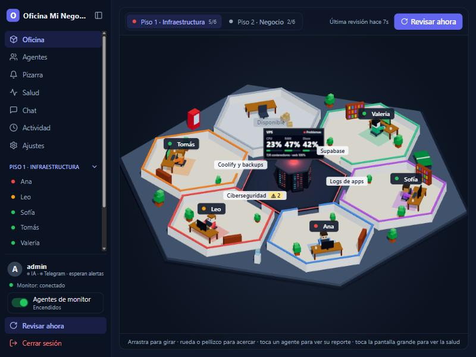
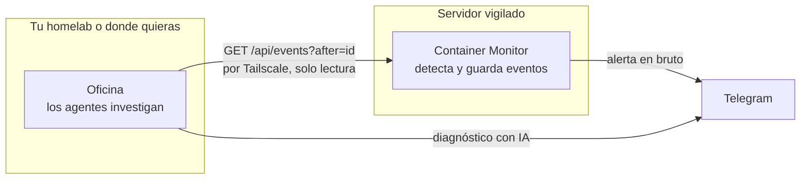

<div align="center">

# Oficina

**Una oficina virtual en 3D donde agentes de IA vigilan tu servidor y te ayudan con el negocio.**




<sub>Captura con datos de demostración.</sub>

</div>

En vez de un tablero más, tu servidor tiene un equipo. Cada agente trabaja en su sala: cuando revisa, se levanta,
camina hasta el servidor del centro y vuelve a su escritorio. Si algo anda mal, deja la alerta en la pizarra, explica
qué pasa y te avisa por Telegram. **Solo observan:** nunca ejecutan nada. Si hay que arreglar algo, te dicen qué
comando correr y lo corres tú.

## Qué hace

| | |
|---|---|
| **Vigila** | CPU, RAM, disco, contenedores, intentos de acceso SSH, puertos abiertos, certificados, logs de cada app, backups de Coolify y Supabase. |
| **Diagnostica** | Las reglas fijas detectan el problema y la IA lo explica en español, con acciones concretas. Sin IA sigue funcionando, solo que sin diagnóstico ni chat. |
| **Conversa** | Puedes preguntarle a cualquier agente sobre lo que vio: «¿qué arreglo primero?». Y ahora también tienes un coordinador por Telegram. |
| **Coordina** | Marco te habla por tu chat privado, le pregunta al equipo, pide revisiones y propone pasar lo difícil a Claude Code —solo si tú apruebas. |
| **Cuida el gasto** | Solo llama a la IA cuando los hallazgos cambian, con tope diario de tokens. También funciona con modelos locales. |
| **Ayuda al negocio** | En el segundo piso, un agente propone ideas para Instagram y otro busca clientes potenciales. Solo trabajan cuando se lo pides y no publican ni contactan a nadie. |

## El equipo

| Agente | Puesto | Se ocupa de |
|---|---|---|
| **Ana** | Informática | Recursos del servidor, contenedores y si la página responde |
| **Leo** | Ciberseguridad | SSH, puertos, certificados, cabeceras y actualizaciones |
| **Sofía** | Logs | Errores, excepciones y respuestas 5xx de cada app |
| **Tomás** | Coolify y backups | Apps, servicios y antigüedad de los respaldos |
| **Valeria** | Supabase | Auth, API REST y que Studio no esté abierto |
| **Marco** | Coordinación | Te habla por Telegram, le pregunta al equipo, pide revisiones y propone pasar lo difícil a Claude Code |
| **Camila** | Contenido | Ideas de publicaciones, listas para copiar |
| **Diego** | Clientes | Negocios reales de un rubro y zona, en una lista exportable |

Nombres, personalidad, especialidad, instrucciones para la IA, umbrales y modelo se cambian en un solo archivo, `config/agentes.json`, sin reiniciar.

## Se conecta con Container Monitor

La Oficina funciona sola, pero rinde mejor junto a
[**Container Monitor**](https://github.com/Ghambitho14/container-monitor), el panel que detecta lo que pasa en tu
servidor. Son dos proyectos independientes: **el monitor detecta y la Oficina investiga**.



1. El monitor detecta, por ejemplo, un contenedor caído y lo guarda como evento.
2. La Oficina pregunta cada 15 segundos «¿qué pasó después del evento N?».
3. El agente encargado se levanta, pide el estado actual, escribe su diagnóstico y te lo manda.

El monitor no sabe que la Oficina existe. Si una de las dos se cae, la otra sigue, y si la Oficina estuvo apagada,
al volver recupera lo que se perdió sin repetir nada. Para conectarlas basta con esto en el `.env`:

```bash
MONITOR_URL=http://<ip-tailscale-del-servidor>:3000
LOCAL_CHECKS=false   # si la Oficina no corre en el servidor que vigila
```

Y encender el botón **Agentes de monitor** en el panel. Los logs por agente requieren Container Monitor 2.4.0 o superior.

## Pruébala en tu PC

Necesitas Node 22.9 o superior.

```bash
git clone https://github.com/Ghambitho14/oficina.git
cd oficina
npm run setup
npm run hash-password -- "tu-contraseña"
```

Crea un `.env` en la raíz con el resultado:

```bash
ADMIN_PASSWORD_HASH=<lo que imprimió hash-password>
SESSION_SECRET=cualquier-texto-largo
ORG_NAME=Mi negocio
```

```bash
npm run dev
```

Abre <http://localhost:5173> y entra con `admin` y tu contraseña. Para desplegarla con Docker Compose o Coolify, sigue
la [guía completa](docs/guia.md).

## Seguridad

- Montajes del host y acceso a Docker **en solo lectura** (a través de `docker-socket-proxy` con `POST=0`).
- Contenedor sin root, con sistema de archivos de solo lectura y sin capabilities.
- Contraseña con bcrypt, cookie `httpOnly` y `SameSite=Strict`, y límite de intentos de acceso.
- Antes de enviar datos a la IA se ocultan IPs, emails, JWT y tokens.
- El chat no tiene herramientas: la IA solo responde texto y no puede ejecutar nada.
- El coordinador de Telegram nunca ejecuta nada; los encargos a Claude Code solo avanzan si tú tocas los botones.
- Claude Code corre fuera del contenedor, con sus propios permisos, y solo el `TELEGRAM_OWNER_ID` puede hablar con el coordinador.

## Stack

Node.js · Express · SQLite · React · Vite · three.js · React Three Fiber · Docker Compose. IA con Claude, Ollama,
OpenCode o cualquier API compatible con OpenAI.

## Documentación

- [Guía completa](docs/guia.md): despliegue, Telegram, modelos, Obsidian y personalización de agentes.
- [Estructura del código](ESTRUCTURA.md): cómo está organizado por dentro.
- `npm test`: corre las pruebas del servidor y compila la web. No usan tu `.env` ni llaman a la IA.
